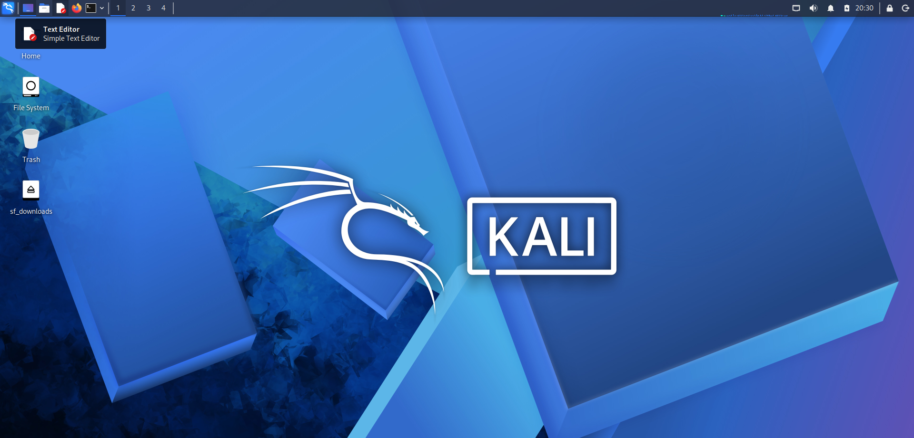
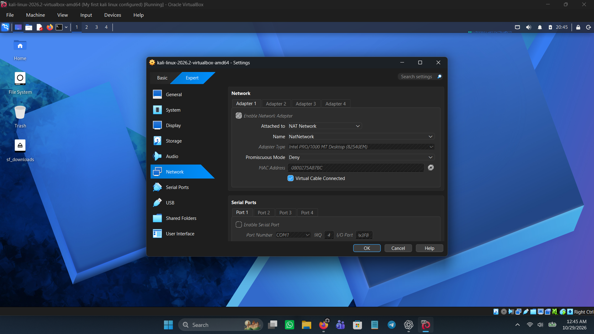
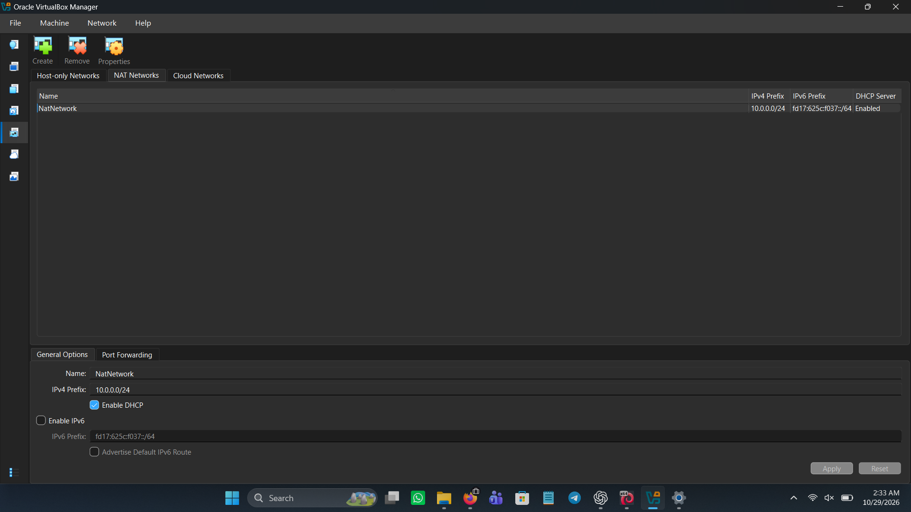
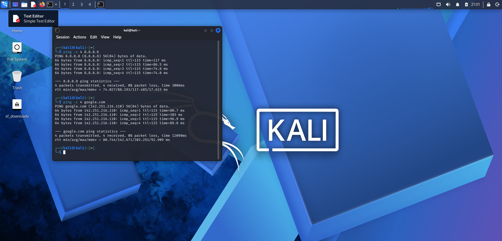

# 🔐 Cybersecurity Lab Setup

**Building a  virtual lab for penetration testing and ethical hacking practice with virtual box and kali linux**

  
  
  
  
  
  
  
  
  
  
  
  

---

## 1. Project Overview

This project documents the setup and configuration of a cybersecurity laboratory using Kali Linux and Oracle VirtualBox. The lab provides a controlled environment for learning networking, cybersecurity tools, and security testing.

The project covers virtual machine setup, NAT Network configuration, IP addressing, internet connectivity verification, shared folders, clipboard integration, and virtual machine snapshots.

## 2. Project Objectives

The objectives of this project are to:

- Install/Configure Virtual box.
- Install/Import Kali Linux as Virtual Machine.
- Create a private NAT Network.
- Configure network connectivity for Kali Linux.
- Assign a consistent IP address for Kali Linux.
- Verify network connectivity and DNS resolution.
- Document the complete setup proccess
- Create a snapshot of the configured virtual machine.
- Establish a foundation for future cybersecurity practical exercises.

## 3. Purpose of the Lab

The lab provides an isolated and controlled environment for cybersecurity learning and authorized security testing.

It can be used for activities such as:

- Network reconnaissance.
- Port scanning.
- Vulnerability assessment.
- Packet analysis.
- Web security testing.
- Exploitation practice.
- Security-tool experimentation.

**Important:** This laboratory must only be used for systems that you own or have explicit permission to test. Do not use the lab or its tools to attack unauthorized systems.

## 4. Tools and Technologies Used

- **Host Operating System:** Windows
- **Virtualization Software:** Oracle VirtualBox
- **Guest Operating System:** Kali Linux
- **Network Configuration:** VirtualBox NAT Network
- **Terminal:** Kali Linux Terminal
- **Shared Folder:** VirtualBox Shared Folders

## 5. Lab Architecture

The laboratory consists of a Windows host computer running Oracle VirtualBox, with Kali Linux operating as a virtual machine.

The Kali Linux virtual machine connects to a configured NAT Network to obtain network connectivity.

### Network Configuration

| Parameter | Configuration |
|---|---|
| Virtual Machine | Kali Linux |
| Network Adapter | Adapter 1 |
| Network Mode | NAT Network |
| NAT Network Name | NatNetwork |
| Network Subnet | 10.0.0.0/24 |
| Kali Linux IP Address | 10.0.0.2 |
| Subnet Mask | 255.255.255.0 |
| Broadcast Address | 10.0.0.255 |
| Gateway | 10.0.0.1 |
| DNS | 8.8.8.8|

## 6. Lab Setup Procedure

### Step 1: Install 7-zip/Oracle VirtualBox

Oracle VirtualBox was installed on the Windows host computer to provide the virtualization environment.

### Step 2: Import Kali Linux

The Kali Linux virtual machine was imported into VirtualBox and started successfully.

### Step 3: Create the NAT Network

A NAT Network named `NatNetwork` was configured in VirtualBox using the subnet `10.0.0.0/24`.

### Step 4: Configure the Virtual Machine Network Adapter

Adapter 1 was configured to use the `NatNetwork` NAT Network.

### Step 5: Configure Kali Linux Networking

Kali Linux was configured with the following network details:

- IP address: `10.0.0.2/24`
- Broadcast address: `10.0.0.255`
- Gateway: `10.0.0.1`

### Step 6: Verify Connectivity

Network connectivity was tested using ping commands and a web connectivity check.

The tests confirmed that Kali Linux could reach an external IP address, resolve a domain name, and access websites.

### Step 7: Configure Shared Folders

A Windows folder located at `C:\downloads` was configured as a VirtualBox shared folder.

The shared folder was accessible from Kali Linux at:

`/media/sf_downloads`

### Step 8: Create a Virtual Machine Snapshot

A snapshot was created with the name:

`My first Kali Linux configured`

This snapshot provides a recovery point for the configured virtual machine.

## 7. Lab Verification

The following checks were completed successfully:

- Kali Linux started successfully in VirtualBox.
- The NAT Network configuration was completed.
- The Kali Linux IP address was configured.
- Ping connectivity to `8.8.8.8` succeeded.
- Domain name resolution for `google.com` succeeded.
- Internet access through the web browser was verified.
- The shared folder was accessed from Kali Linux.
- Clipboard and drag-and-drop functionality were tested.
- A virtual machine snapshot was created.

## 8. Problems Encountered and Solutions

### Network Configuration

**Challenge:** Ensuring that Kali Linux used the correct network configuration.

**Solution:** Configured the virtual machine's network adapter to use `NatNetwork` and verified the network settings.

### Shared Folder Access

**Challenge:** Identifying the shared folder location inside Kali Linux.

**Solution:** Accessed the shared folder through `/media/sf_downloads`.

### Connectivity Verification

**Challenge:** Confirming that both IP connectivity and domain name resolution worked.

**Solution:** Used ping tests and a web browser to verify network connectivity.

## 9. What I Learned

Through this practical exercise, I gained experience in:

- Virtual machine setup and management.
- Kali Linux configuration.
- Virtual networking using NAT Network.
- IP addressing and subnet masks.
- Basic network connectivity troubleshooting.
- Shared folders between host and guest operating systems.
- Virtual machine snapshots and recovery.
- Documenting practical cybersecurity work using GitHub.

## 10. Security and Ethical Use

This laboratory is intended for educational purposes and authorized security testing.

All cybersecurity activities must be conducted in controlled environments or on systems for which explicit permission has been granted.

Unauthorized access, attacks against third-party systems, and other illegal activities are prohibited.

## 11. Project Screenshots

### Screenshot 1: Kali Linux Virtual Machine

This screenshot shows Kali Linux running inside Oracle VirtualBox.

### Screenshot 2: Kali Linux Network Adapter Configuration

This screenshot shows the virtual machine's network adapter configured to use `NatNetwork`.

### Screenshot 3: NAT Network Configuration

This screenshot documents the NAT Network configuration in VirtualBox.

### Screenshot 4: Connectivity Verification

This screenshot shows the terminal connectivity tests performed in Kali Linux.

## 12. Future Improvements

Possible future improvements include:

- Adding additional virtual machines for network testing.
- Practicing network scanning in the controlled lab.
- Learning packet analysis.
- Performing authorized vulnerability assessments.
- Documenting additional cybersecurity practical exercises.

## 13. References

- [Kali Linux Official Website](https://www.kali.org/)
- [Oracle VirtualBox Official Website](https://www.virtualbox.org/)
- [GitHub Documentation](https://docs.github.com/)

## 14. Author

**John Dadzie**

Cybersecurity Student | Aspiring Cybersecurity Professional

LinkedIn: [John Dadzie](https://www.linkedin.com/in/john-dadzie-a10404418/)
